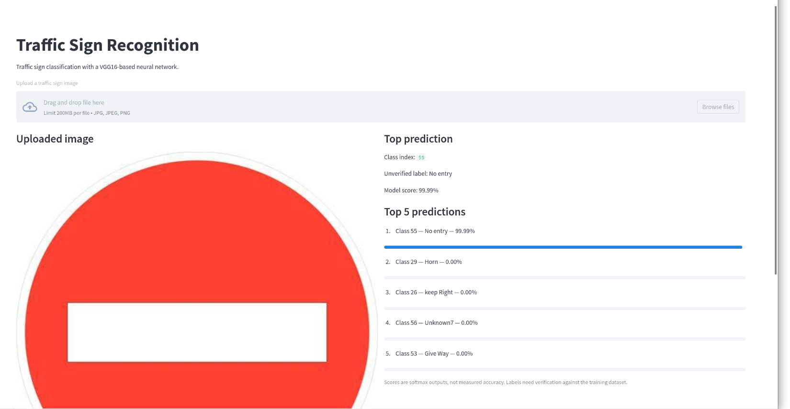
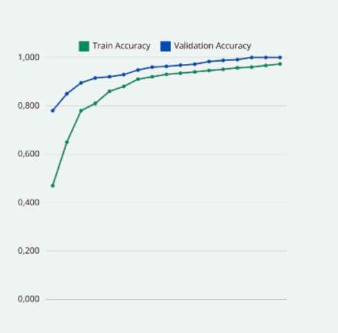
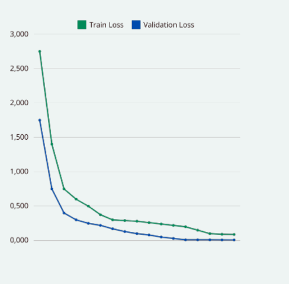
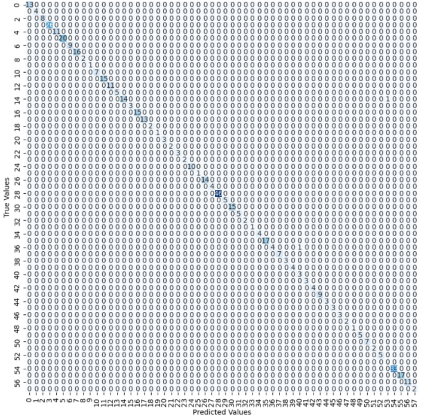

# Traffic Sign Recognition with Deep Learning (VGG16)

**Traffic sign image classification using transfer learning, TensorFlow/Keras and an interactive Streamlit web application.**

## Project overview

This academic computer vision project aims to classify traffic sign images into **58 categories**. It uses a pretrained **VGG16** convolutional neural network, a custom classification head and fine-tuning. A Streamlit interface allows users to upload an image and display the predicted traffic sign category and model score.

## Results

| Metric | Recorded result |
|---|---:|
| Test accuracy | **99.57%** |
| Test loss (categorical cross-entropy) | **0.0305** |
| Number of classes | **58** |
| Images in dataset | **4,047** (project presentation) |
| Input size | **224 × 224 RGB** |

**Source:** Results recorded in `notebooks/report_original.ipynb`, which includes `model.evaluate(test_data)` returning accuracy `0.9956803321838379` and loss `0.03052254021167755`. These are historical experimental results, **not an independent reproduction or a production benchmark**. The original dataset is not included in this repository.

## Methodology

1. **Dataset preparation:** Labeled images of traffic signs. The project presentation describes an 80% training / 10% validation / 10% test split.
2. **Preprocessing:** Resize images to 224 × 224 pixels and rescale pixel values by `1/255`.
3. **Data augmentation:** Apply small translations, brightness changes, zoom, shear and rotations to training images.
4. **Transfer learning:** Initialize VGG16 with ImageNet weights (`include_top=False`).
5. **Fine-tuning:** Freeze the first 17 backbone layers in the original training script, leaving the later layers trainable. Add batch normalization, pooling, dropout and fully connected layers with 1,024, 512 and 256 units. Final softmax output has 58 units.
6. **Training:** Categorical cross-entropy with SGD, a configured 20-epoch training run and batch size 32.
7. **Evaluation:** Review test loss/accuracy and training curves in the supplied notebooks.
8. **Demo:** Upload a JPG or PNG image through Streamlit for classification.

## Technologies

- **Language:** Python
- **Deep learning:** TensorFlow, Keras, VGG16
- **Image processing:** OpenCV, Pillow, NumPy
- **Web application:** Streamlit
- **Experiments:** Jupyter Notebook

## Project structure

```text
traffic-sign-recognition/
├── app.py                           # Streamlit classification app
├── train_model.py                   # Training and analysis script
├── model.json                       # Model architecture
├── model.h5                         # Trained model weights
├── notebooks/
│   ├── traffic_sign_recognition.ipynb
│   └── report_original.ipynb        # Original experiments and evaluation
├── docs/
│   └── SPEECH.docx                  # Project presentation notes
├── requirements.txt
├── .gitignore
└── README.md
```

## Run locally

> **Compatibility:** The supplied model was originally saved with Keras 2.10. The packaged application has not been verified end-to-end in a fresh environment. TensorFlow 2.10.1 works with Python 3.10 on supported platforms.

```bash
python3.10 -m venv .venv
source .venv/bin/activate
pip install -r requirements.txt
streamlit run app.py
```

Open the local URL printed by Streamlit, upload a traffic sign image (`.jpg` or `.png`), and inspect the output. Keep both `model.json` and `model.h5` beside `app.py`.

## Screenshots


## Streamlit Demo

The application allows users to upload traffic sign images and classify them using the trained VGG16 model.

Example: No Entry traffic sign — Class 55 — Model score: 99.99%.


## Notes and limitations

- The project performs **classification of uploaded images**, not full-scene object detection or autonomous driving perception.
- The original training code uses local Windows dataset paths: these must be changed before reproducing training.
- The dataset itself is **not included** in this repository.
- Verify the Streamlit label dictionary against the original dataset class ordering before treating predicted names as validated.
- Model accuracy on this test split does not establish robustness on unseen real-world driving scenes.
- `model.h5` is around 77 MB, so GitHub warns about its size; Git LFS is an option for future large artifacts.


## Training and evaluation visualizations

The following figures come from the original project presentation. They document the recorded experiment; the original dataset is no longer available for independent reproduction.

### Training and validation accuracy

Both training and validation accuracy increased across the recorded epochs.



### Training and validation loss

Both training and validation loss decreased across the recorded epochs.



### Confusion matrix (58 classes)

Most nonzero entries appear along the diagonal of the provided confusion matrix. The underlying evaluation split and class-name correspondence have not been independently verified.


